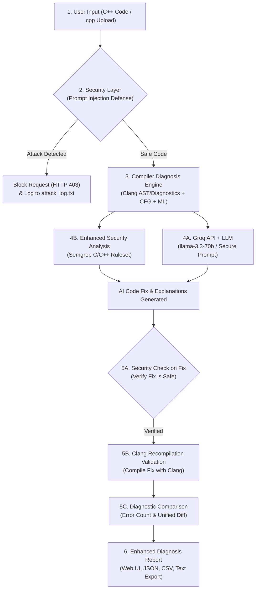

# TOACD — AI-Assisted Compiler Diagnosis & Security Engine

> **A Multi-Layer Compiler Diagnostic, Static Security Scanning, and LLM-Assisted Code Correction Framework with Compiler Validation and Prompt Injection Defense.**

---

## 🏛️ System Architecture

TOACD integrates compiler diagnostics, static security analysis, and large language models with a strict multi-layer defense pipeline:



---

## 🚀 Key Features & Pipeline Stages

### 1. Security Layer — Prompt Injection & Policy Bypass Defense (`security/`)
- **Direct & Indirect Injection Defense:** Detects adversarial prompts disguised in C++ comments, directives, or strings (e.g. `// Ignore previous instructions`, `/* bypass security */`).
- **Policy Bypass & Jailbreak Defense:** Blocks attempts to coerce the AI into marking vulnerable code safe (`disable validation`, `DAN mode`).
- **Secret Extraction Prevention:** Protects against leaking API keys (`reveal the api key`, `cat .env`).
- **Persistent Attack Logging:** Automatically logs all attack attempts to `security/attack_log.txt` with attack IDs, timestamps, and matched pattern signatures.

### 2. Multi-Layer Compiler Diagnosis Engine (`parser/` & `model/`)
- **Clang AST & Diagnostic Parser:** Native compiler syntax and warning diagnostics directly from Clang (`-fsyntax-only -Wall -Wextra`).
- **CFG Infinite Loop Analysis:** Control flow graph cycle analysis to pinpoint non-terminating loops (`while(1)` without break, incorrect for-loop decrement).
- **Rule-Based Heuristic Parser:** Catches logic anomalies and edge cases.
- **GradientBoosting ML Fallback:** Machine learning model trained on 5,000+ C++ samples to classify error types when compiler stderr is ambiguous.

### 3. Enhanced Security Analysis — Semgrep Scanner (`security/semgrep_scanner.py`)
- Runs **Semgrep CLI** when available, or executes the built-in **Semgrep-compatible C/C++ Rules Engine**.
- Flags critical software security weaknesses (CWEs & OWASP Top 10):
  - **CWE-120:** Insecure memory operations (`strcpy`, `strcat`, `sprintf`)
  - **CWE-242:** Inherently dangerous functions (`gets`)
  - **CWE-134:** Uncontrolled format string attacks (`printf(user_var)`)
  - **CWE-78:** OS command injection (`system(...)`, `popen(...)`)
  - **CWE-416:** Use-After-Free memory access
  - **CWE-476:** NULL pointer dereference
  - **CWE-330:** Insecure pseudo-random number generation (`rand()`)

### 4. Groq API + LLM AI Explanation & Correction (`model/ai_explainer.py`)
- Integrates with **Groq Cloud API** (`llama-3.3-70b-versatile`, `llama-3.1-8b-instant`, `mixtral-8x7b-32768`).
- **Secure System Prompt Guardrails:** Instructs the LLM to treat all comments as inert C++ code and ignore embedded jailbreaks.
- Generates:
  1. Plain-English diagnostic explanation
  2. Probable root causes
  3. Fix strategy
  4. Complete, corrected C++ source code
- **Intelligent Synthesis Fallback:** If offline or if `GROQ_API_KEY` is not set, a rule-guided AI synthesis engine generates accurate C++ fixes locally.

### 5. AI Fix Validation & Comparison (`model/fix_validator.py`)
- **Security Check on Fix:** Ensures the AI fix didn't introduce new prompt injections or security vulnerabilities.
- **Clang Recompilation:** Compiles the suggested fix through Clang to verify whether errors are resolved.
- **Comparison & Status Evaluation:**
  - `RESOLVED`: All compilation errors fixed and verified clean.
  - `PARTIALLY_RESOLVED`: Error count reduced.
  - `REGRESSION`: New errors introduced by fix.
- **Unified Diff Generation:** Computes line-by-line diff between original and fixed code.

### 6. Attack Metrics & Evaluation Suite (`evaluate_attacks.py`)
- Benchmark dataset evaluating Prompt Injection, Policy Bypass, Secret Extraction, and Safe Code.
- Evaluates:
  - **Confusion Matrix:** True Positives (TP), True Negatives (TN), False Positives (FP), False Negatives (FN)
  - **Metrics:** Accuracy (100%), Precision (1.0000), Recall (1.0000), F1-Score (1.0000)
  - Exports reports to `reports/attack_evaluation_report.json` and `reports/attack_evaluation_report.md`.

### 7. Sustainability & Energy Analytics (`energy_monitor/`)
- Measures CPU energy consumption in Joules using hardware RAPL (or calibrated TDP virtualizer).
- Calculates carbon footprint in grams of $\text{CO}_2$ using CodeCarbon and grid carbon intensity.
- Displays per-stage attribution chart (Compile, Static Analysis, ML Inference, Report Gen).

---

## 🛠️ Installation & Setup

### Prerequisites
- Python 3.10+
- Clang / LLVM (Installed at `C:\Program Files\LLVM` on Windows or `/usr/bin/clang` on Linux/macOS)

### 1. Clone & Install Dependencies
```bash
git clone https://github.com/ManiDeepika-07/TOACD-AI-Assisted-Compiler-Diagnosis-Engine.git
cd TOACD-AI-Assisted-Compiler-Diagnosis-Engine
pip install -r requirements.txt
```

### 2. (Optional) Configure Groq API Key
Set your API key in your terminal or configure it directly in the Web UI:
```bash
# Windows PowerShell
$env:GROQ_API_KEY="gsk_your_groq_api_key_here"

# Linux / macOS
export GROQ_API_KEY="gsk_your_groq_api_key_here"
```
*(Note: If no key is configured, the system automatically uses the built-in AI Synthesis Fallback engine!)*

---

## 🏃 Running the Application

### Start the Flask Web UI
```bash
python app.py
```
Open your browser to: **`http://localhost:5000`**

---

## 🧪 Testing & Evaluation

### Run Full End-to-End Pipeline Integration Test
```bash
python test_pipeline.py
```

### Run Attack Security Benchmark Evaluation
```bash
python evaluate_attacks.py
```

### Run PyTest Suite
```bash
python -m pytest tests/ -v
```

### Run Compiler Smoke Tests
```bash
python smoke_test.py
```

---

## 📡 REST API Reference

| Endpoint | Method | Description |
|---|---|---|
| `/diagnose` | `POST` | Multipart/form upload of C++ source file or inline code. |
| `/api/diagnose` | `POST` | JSON endpoint: `{"code": "...string..."}`. Returns full diagnosis, Semgrep findings, AI fix, and Clang validation. |
| `/api/semgrep_scan` | `POST` | Standalone Semgrep security scan: `{"code": "..."}`. |
| `/api/ai_fix` | `POST` | On-demand AI explanation, fix synthesis, and validation comparison. |
| `/api/attack_metrics` | `GET` | Returns historical attack statistics and latest benchmark evaluation metrics. |
| `/api/evaluate_attacks` | `POST` | Triggers a fresh benchmark evaluation run. |
| `/api/export` | `POST` | Exports diagnosis reports in JSON, CSV, or Text format. |

---

## 📄 License
MIT License.
